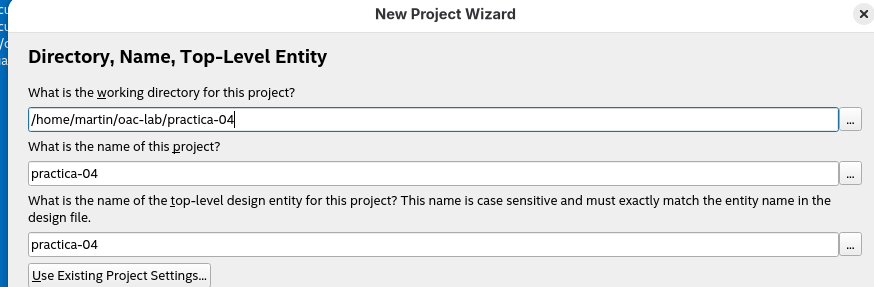
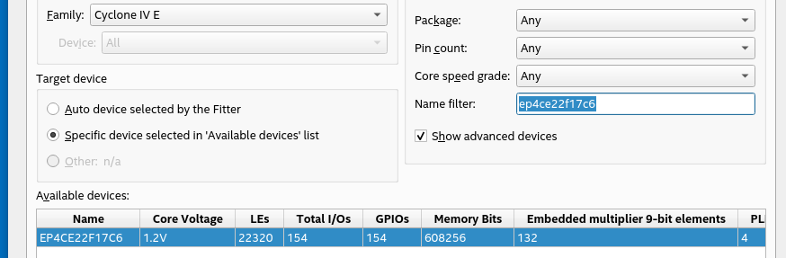

## Practica 04

### Objetivos

Conocer y usar las librerías de módulos LPM (  Lybrary of Parametrized Modules)

#### Creación de un nuevo proyecto

Elegimos el modelo de dispositivo FPGA **ep4ce22f17c6** que corresponde a la Cyclone IV

