## Practica 04

### Objetivos

Conocer y usar las librerías de módulos **LPM** (  Lybrary of Parametrized Modules)

### Creación de un nuevo proyecto


Elegimos el modelo de dispositivo FPGA **ep4ce22f17c6** que corresponde a la Cyclone IV


Como herramienta de simulación se eligió Questa en lugar de ModelSim

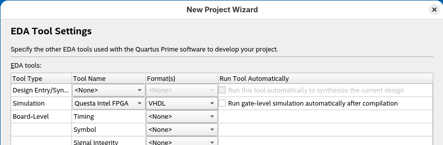

### Agregar Librería LPM_ADD_SUB

del **IP Catalog** Seleccionamos la librería LPM_ADD_SUB

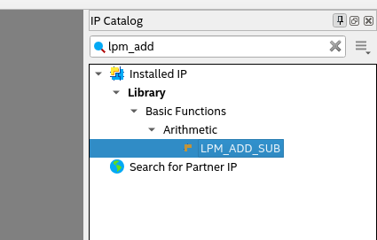

Del tipo VHDL en el directorio de la práctica actual, con el nombre **add_sub_lib**

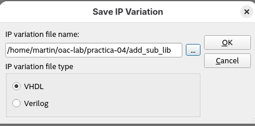  

De 8 bits

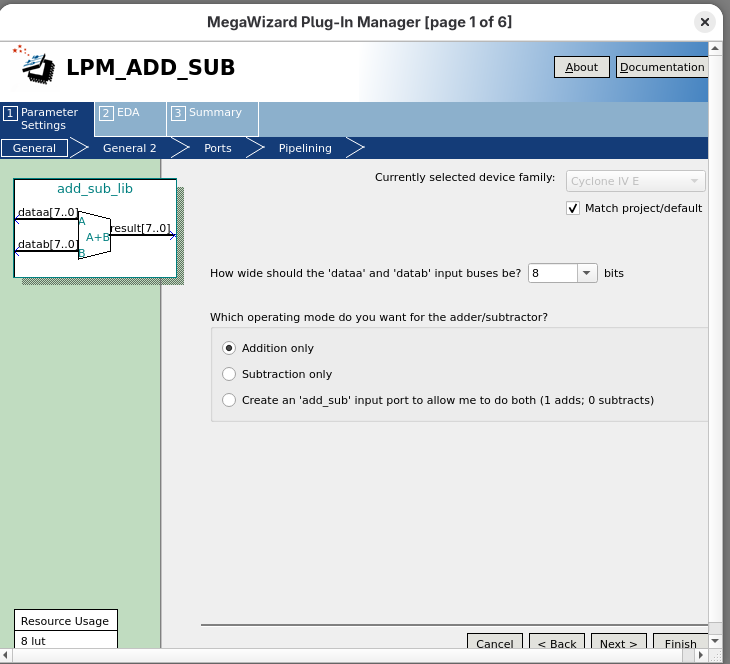 

Opciones de entrada/ salida

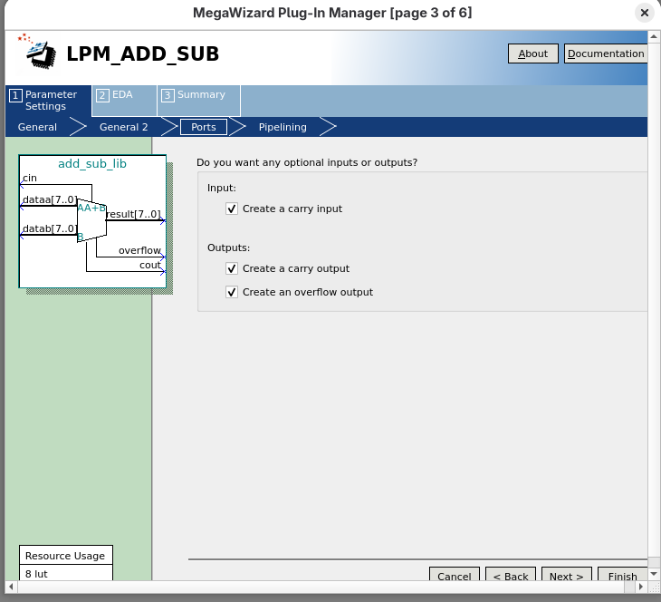

sin pipeline

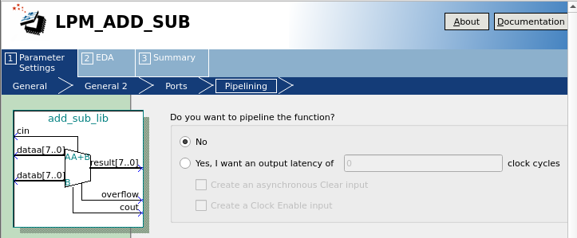

Elegimos incluir solamente el archivo de definición

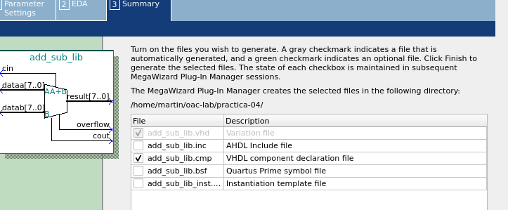

Confirmamos el archivo a generar

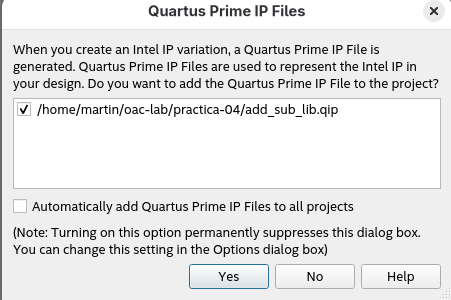

### Compilar el proyecto

Se selecciona la libraría como top level entity

Y luego se compila

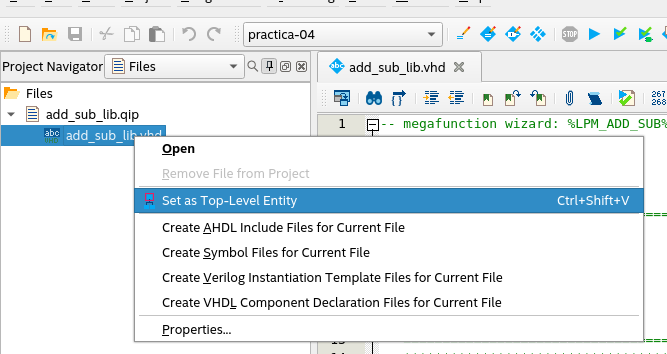

Resultado del RTL Viewer

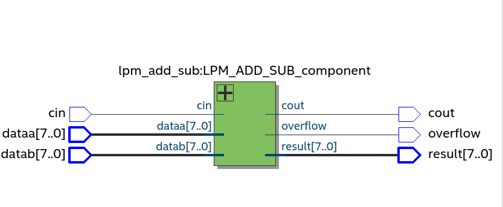

### Simulación

Como al inicio se eligió Questa como herramienta de simulación, es la herramienta que se lanza al hacer clic en **Gate Level Simulation**

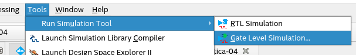

Interfáz de Questa

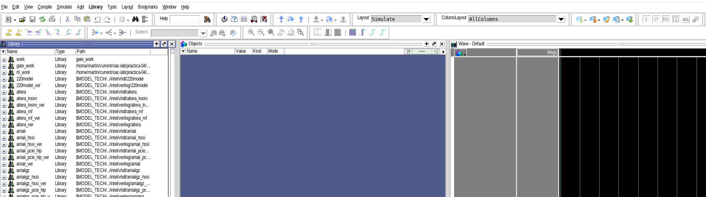


#### Preparar la simulación

1. En library se selecciona **add_sub_lib**
   
   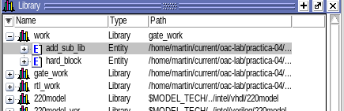

2. En la sección **Objects** se seleccionan las señales de interés
   
   1. 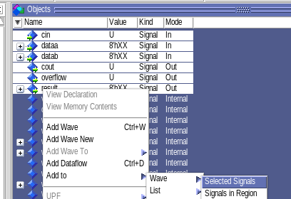
      
      Y se hace clic en **add to -> wave -> selected Signals**

3. En la sección **Wave Default**
   
   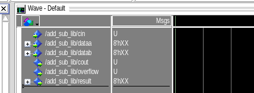
   
   Se fuerzan lo valores de prueba
   
   Por ejemplo : 
   
   - 5 para dataa
   
   - 8 para datab
   
   - 0 para cin
     
     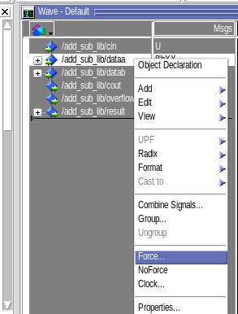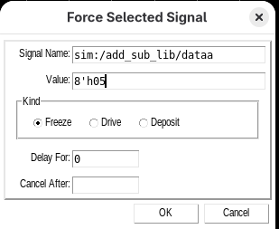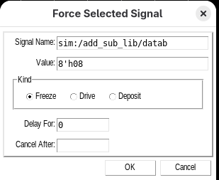

Questa acepta comandos, asi que ejecutamos

```bash
run 30 ns
```

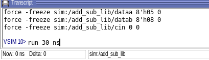

Obtenemos el siguiente resultado

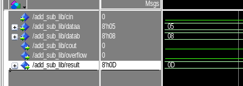

Que corresponde con lo esperado 5 + 8  = 0D en exadecimal

#### Probar con otros datos

Ahora cambiamos el radix de los puertos a decimal

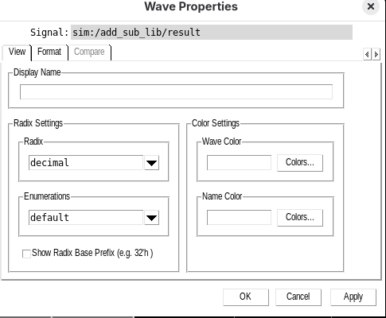

Y agregamos otros valores, mal altos, ya que al ser de 8 bits alcanza valores de hasta 255

para dataa 50

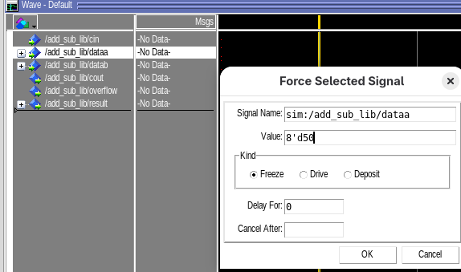

para datab 50 también

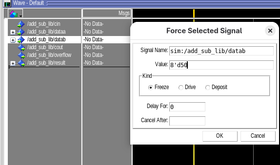

cin en cero

Lo corremos 10 ns

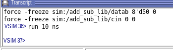

y observamos como resultado 50 + 50 = 100

Con lo que la librería suma de manera correcta

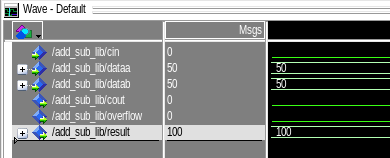

## Conclusiones

Conocer la existencia de estas librerías nos ayuda a no tener que generar todos los componentes VHDL desde cero, por ejemplo, hay una librería para implementar Ethernet. y muchas librerías aritméticas, además de que al contar con un configurador, es sencillo personalizar la librería de acuerdo con nuestras necesidades. Por lo que en adelante, cuando requiera una funcionalidad avanzada y general, en lugar de pensar en crearla por mi mismo, primero haría una búsqueda en esta biblioteca.


